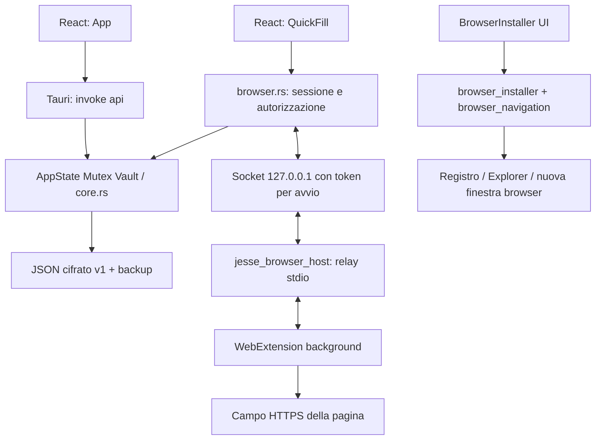

# Architettura di JesseArchive

## Baseline e metodo

Analisi statica del 17 novembre 2026, versione applicativa 1.1.4, HEAD `1f09624`. Sono stati censiti **87 file versionati: 79 testuali e 8 asset binari**. Sorgenti, configurazioni, test, script e note storiche sono stati esaminati; per l'HTML legacy è stata anche indicizzata la struttura JavaScript tramite AST, per gli asset sono stati controllati formato, dimensioni e duplicazioni. I lockfile sono stati letti come manifest risolti, non come codice applicativo.

Esclusi dall'analisi funzionale: implementazioni delle dipendenze in `node_modules/`, output in `dist/`, `target/`, `src-tauri/target/`, cache, profili di prova e altri file ignorati. Non sono state aperte configurazioni personali o vault reali. Questi output non diventano sorgenti canoniche solo perché presenti sul disco.

Le evidenze si distinguono in: **codice verificato**, **prove della sessione di sviluppo precedente** e **Da verificare**. Questo incarico non avvia l'app, non esegue migrazioni e non ricompila sorgenti. Le guide storiche in root documentano revisioni precedenti; alcune affermazioni, come “mai compilato” o “nessun remoto”, non descrivono più lo stato attuale. Per decisioni tecniche prevalgono i sorgenti correnti; queste pagine devono rimanere sincronizzate con essi.

## Componenti e flussi

L'interfaccia Tauri usa IPC nativo, non il server HTTP del vecchio client Python. L'unico listener applicativo del client Rust è il bridge browser loopback: usa JSON incorniciato e non espone route HTTP generiche del vault.

## Mappa dei file attivi

| File/area | Responsabilità |
|---|---|
| [main.rs](../src-tauri/src/main.rs) | Entry point desktop, soppressione console nelle build release |
| [lib.rs](../src-tauri/src/lib.rs) | Builder, stato condiviso, registrazione comandi, eventi e integrazione OS |
| [core.rs](../src-tauri/src/core.rs) | Modello dinamico, envelope crittografico, persistenza, dispatcher e utility |
| [browser.rs](../src-tauri/src/browser.rs) | `Bridge`, listener, scorciatoie, selezione account e messaggi di riempimento |
| [browser_protocol.rs](../src-tauri/src/browser_protocol.rs) | Identificatori, directory e framing condiviso |
| [jesse_browser_host.rs](../src-tauri/src/bin/jesse_browser_host.rs) | Secondo binario Cargo; relay tra browser e app già aperta |
| [browser_installer.rs](../src-tauri/src/browser_installer.rs) | Catalogo fisso di sei browser, rilevamento e apertura guida |
| [browser_navigation.rs](../src-tauri/src/browser_navigation.rs) | Navigazione Win32 controllata, compilata solo su Windows |
| [src/main.tsx](../src/main.tsx) | Dispatch React secondo query string |
| [App.tsx](../src/App.tsx) | Schermata auth, shell, pagine, editor e dialoghi condivisi |
| [QuickFill.tsx](../src/QuickFill.tsx) | Sblocco e selezione account senza ricevere l'intero vault nel pannello |
| [BrowserInstaller.tsx](../src/BrowserInstaller.tsx), [BrowserSettings.tsx](../src/BrowserSettings.tsx) | Configurazione guidata e preferenze browser |
| [NewsPanel.tsx](../src/NewsPanel.tsx), [news-changelog.ts](../src/news-changelog.ts), [commits.generated.json](../src/commits.generated.json) | Novità curate, cronologia Git e timestamp per voce |
| [api.ts](../src/api.ts), [types.ts](../src/types.ts) | Wrapper `invoke` e tipi frontend; non validano da soli dati esterni |
| [theme.ts](../src/theme.ts), [style.css](../src/style.css) | Otto preset, palette personalizzata e stile responsive |
| [updater.rs](../src-tauri/src/updater.rs), [Updater.tsx](../src/Updater.tsx) | Aggiornamento automatico. **Comandi:** `update_settings`, `update_set_auto`, `update_check`, `update_install`; i comandi di rete sono async con `spawn_blocking`. **Evento:** `update-progress`. **Flusso:** verifica del manifest firmato Ed25519, download in `%TEMP%\JesseArchive-Update`, avvio del setup con `ShellExecuteW` (UAC) e `/SILENT /INSTALLDIR=<cartella attuale>`, blocco del vault e uscita. **UI:** controllo automatico solo a vault sbloccato e una volta per versione per sessione, pannello «Aggiornamenti», barra di download |
| [i18n.ts](../src/i18n.ts), [LanguageMenu.tsx](../src/LanguageMenu.tsx), [locales/](../src/locales/), [i18n.rs](../src-tauri/src/i18n.rs) | Lingua dell'interfaccia. **Frontend:** `t()` usa il testo italiano come chiave e cade sull'italiano se manca la voce. `tRich()` inserisce elementi React nei segnaposto, `msg()` marca le costanti. `translateMessage()` traduce i messaggi del backend e dell'estensione, anche con parti variabili, usando le chiavi con `{segnaposto}` come modelli; la logica che riconosce i messaggi (per esempio "Vault bloccato") lavora sul testo italiano originale. Al cambio di lingua la radice di ogni finestra si ridisegna (`useLanguage` in `main.tsx`). **Backend:** comandi `language_get`/`language_set`, preferenza `lang` del dispositivo, etichette del tray e titoli delle finestre `quick-fill`/`browser-setup`, evento `language-changed` a tutte le finestre. **Altro:** News tradotte in `locales/news/`, nome dell'estensione nei `_locales` del browser, testi dell'installer nei `[CustomMessages]` di Inno |
| [zoom.rs](../src-tauri/src/zoom.rs), [zoom.ts](../src/zoom.ts) | Zoom dell'interfaccia: livelli 50–200%, comandi `zoom_get`/`zoom_change`, evento `zoom-changed`, applicato con `set_zoom` a tutte le finestre (la finestra rapida, non ridimensionabile, scala anche le dimensioni); scorciatoie e indicatore installati da `main.tsx` in ogni finestra |

Non ci sono directory service/repository/domain separate: molte responsabilità risiedono nel monolite `core.rs`; molte schermate sono funzioni nello stesso `App.tsx`. Questa descrizione riguarda il codice reale e non un'architettura a livelli già realizzata.

## Bootstrap e ciclo di vita

1. `main.rs` chiama `run()` della libreria.
2. Il Builder installa i plugin global-shortcut e single-instance e gestisce `AppState(Mutex<core::Vault>)`.
3. `Vault::new` determina configurazione e percorso del file; non sblocca il vault.
4. `browser::setup` apre il listener, scrive il descrittore di connessione, tenta la registrazione della scorciatoia e crea `quick-fill` nascosta. Un errore della scorciatoia è conservato per l'interfaccia; altri errori di setup possono impedire l'avvio.
5. `run` crea menu e tray. `--background` nasconde `main`; `--browser-setup` apre la guida e nasconde `main`.
6. Un secondo avvio riporta in primo piano la finestra principale oppure apre la guida, secondo gli argomenti.

| Finestra | Componente | Chiusura |
|---|---|---|
| `main` | `App` | Preferenza `quit`: uscita; `tray`: blocco del vault e finestra nascosta |
| `quick-fill` | `QuickFill`, query `?quick-fill` | Annulla la sessione, pulisce lo stato UI del pannello e nasconde la finestra |
| `browser-setup` | `BrowserInstaller`, query `?browser-setup` | Nasconde la guida; il processo può rimanere nel tray. Il pulsante "Ho installato l'estensione" chiama `browser_setup_finish`, che mostra e mette a fuoco `main` e poi nasconde la guida |

Tutte e tre compaiono in [capabilities/default.json](../src-tauri/capabilities/default.json), con `core:default`. I comandi applicativi registrati nel Builder non hanno un ulteriore controllo per etichetta della finestra.

## Interfaccia principale e dispatcher

`App` mantiene il vault decifrato come stato React. `refresh` interroga `status` e poi `state`; `mutate` usa lo stato ritornato dal comando oppure aggiorna. `run` normalizza gli errori e gestisce `busy`, ma non elimina automaticamente il vecchio stato React su ogni errore di sessione.

Il componente esegue `ping` ogni 15 secondi mentre dispone di un vault e ascolta `vault-changed` e `vault-locked`. Non usa il numero `rev` per ricaricare automaticamente il contenuto a ogni aggiornamento remoto. Su tastiera, clic e rotella invia `touch` al massimo ogni 30 secondi; su `vault-locked`, o se un comando risponde "Vault bloccato"/"Sessione scaduta", `wipeSession` azzera tutto lo stato sensibile. Nel backend, `api` emette `vault-locked` quando un comando fa passare il vault da sbloccato a bloccato, e il thread `spawn_idle_lock` controlla la scadenza ogni 5 secondi con `try_lock`.

`api(app, state, name, body)` acquisisce il mutex e chiama `Vault::call`. La forma del messaggio è un nome stringa e un oggetto JSON, non un enum tipizzato condiviso. La risposta è `Value` oppure un errore stringa. Le operazioni restano serializzate, incluse parti di I/O, scrypt e richieste HTTP eseguite sotto il mutex.

| Famiglia | Comandi di `Vault::call` |
|---|---|
| Stato/sessione | `status`, `ping`, `create`, `unlock`, `lock`, `touch`, `show`, `state`, `browser_state` |
| Elementi e organizzazione | `item`, `trash`, `delete`, `bulk`, `folder`, `group_edit` |
| Storico e generatori | `pw_save`, `pw_link`, `pw_del`, `pw_bulk`, `generate` |
| Sicurezza e preferenze | `health`, `breach`, `totp`, `settings`, `master`, `recovery_new`, `prefs_set` |
| Trasferimento dati | `pack`, `unpack`, `export`, `import`, `loc_use`, `loc_move` |
| Utility | `group_logo`, `apps`, `app_icon`, `suggest` |

`show` nel core è un no-op riuscito: il ripristino effettivo della finestra è nei callback Tauri, non in questa route. Gli altri comandi nativi (`choose_file`, `choose_icon_data`, `read_file`, `save_file`, clipboard e `browser_*`) sono registrati separatamente e non attraversano necessariamente il gate di `Vault::call`.

## Persistenza e sincronizzazione

`save` chiama `pull`, cifra l'intero payload e invoca `atomic_write`. `pull` confronta firma del file, prova a decifrare la copia cambiata e legge eventuali `jesse_archive*.vault` nella stessa cartella. `merge_data` sceglie record per timestamp e applica tombstone. Non ci sono transazioni SQL, lock distribuiti o watch service dei provider cloud. [DATABASE](DATABASE.md) descrive schema, priorità dei timestamp, backup e limiti.

Il JSON consente estensioni e compatibilità, ma molte funzioni assumono che array e oggetti abbiano la forma attesa; i tipi TypeScript non garantiscono la validità dei dati importati o decifrati.

## Passkey WebAuthn, passo per passo

1. `passkey-page.js` (MAIN world, `document_start`, frame principale HTTPS) intercetta `navigator.credentials.create/get`. Le richieste `mediation: "conditional"` e le opzioni non valide restano al browser.
2. Le opzioni, codificate in base64url, passano con `postMessage` a `passkey-bridge.js` (mondo isolato), poi con `runtime.sendMessage` al background, che aggiunge l'origine da `sender.url`.
3. Il background invia `{kind:"passkey"}` all'host nativo. `browser.rs` lo passa a `passkey::request`, che valida la richiesta.
4. **Risposta immediata senza finestra:**
   - fallback se le passkey sono disattivate;
   - fallback per un accesso a vault sbloccato senza passkey del sito;
   - fallback se un'altra richiesta è già in corso;
   - `SecurityError` se l'rpId non è valido.
5. **Altrimenti:** la richiesta resta in `Passkeys` e la mini finestra riceve `passkey-changed`.
6. **Comandi UI:** `passkey_state`, `passkey_approve` (crea la scheda con il comando `item` del vault, oppure firma), `passkey_fallback`, `passkey_cancel`; impostazioni con `passkey_settings`/`passkey_set_enabled` (`passkeys` nella configurazione dispositivo).
7. **Esito:** l'app risponde con `passkey-result`. Il background rimette a fuoco la finestra del browser e consegna il risultato. La pagina costruisce un `PublicKeyCredential`, rilancia l'errore DOM o richiama l'API nativa (fallback).
8. **Interruzioni:** un abort della pagina, il timeout del background o la disconnessione dell'host inviano `passkey-cancel` oppure annullano la richiesta in corso.

## Integrazione browser, passo per passo

1. La scorciatoia chiama `browser::request`: una sola richiesta globale attiva, con identificatore casuale; una risposta di contesto è accettata entro 5 secondi.
2. Il worker dell'estensione verifica finestra attiva, scheda HTTPS e input selezionato. Usa `scripting.executeScript` in tutti i frame; accetta soltanto un frame con origine uguale alla pagina principale.
3. `receive` conserva URL, URL principale, client e richiesta. Il controllo del Rust usa `host`; quello dell'estensione è un confronto di origini più stretto. Il timeout della selezione è 120 secondi.
4. `browser_accounts` usa `browser_state` e restituisce ID, titolo e username degli account compatibili, non le password. Il pannello può sbloccare il core tramite IPC.
5. `same_account_site` normalizza URL salvati senza protocollo, richiede HTTPS sulla destinazione, confronta porta e dominio registrabile tramite PSL, inclusi i suffissi privati. La logica non viene usata per allargare l'accesso agli iframe.
6. `browser_fill` ricontrolla stato del vault, scadenza, ID e sito; solo dopo invia username/password al client selezionato.
7. L'estensione ricontrolla richiesta, scheda, URL e riferimento DOM. Inserisce valori con setter nativo e notifiche `input/change`, sposta il focus, ma non invia il modulo. `Tab` è un evento sintetico, non una garanzia di tabulazione OS.
8. Il messaggio `filled` termina la sessione; il pannello mostra l'esito e si richiude. Login a schermate separate richiedono un nuovo richiamo del pannello.

Il relay usa 4 byte little-endian di lunghezza e un oggetto JSON UTF-8, massimo 262144 byte. Il primo frame TCP porta il token per avvio. Il listener autentica entro 3 secondi e poi mantiene la connessione; non c'è TLS. L'helper legge il descrittore da AppData, controlla gli identificatori ammessi negli argomenti e inoltra i frame. Non avvia automaticamente l'app se è chiusa. Vedere [SECURITY](SECURITY.md) per il modello di fiducia locale.

Eventi principali: `vault-changed`, `vault-locked`, `browser-changed`, `browser-result`, `browser-dismissed`, `zoom-changed`, `update-progress`, `passkey-changed`, `language-changed`. Il pannello rapido aggiorna i metadati ogni 3 secondi quando attivo; le impostazioni browser interrogano lo stato ogni 5 secondi.

## Guida e risorse di distribuzione

`browser_installer` rileva eseguibili da App Paths nelle viste registro 32/64 bit e da directory standard. I sei identificatori sono una allowlist fissa. `browser_navigation` apre una nuova finestra `about:blank`, cerca una nuova HWND del browser atteso e inserisce l'indirizzo dalla barra dopo aver verificato il primo piano. Non installa estensioni né modifica profili.

La sorgente canonica del worker è [browser-extension/background.js](../browser-extension/background.js). Le copie in `chromium/` e `firefox/` sono generate e risultavano identiche nell'analisi. `public-key.txt` contiene una chiave pubblica per stabilizzare l'ID Chromium, non un segreto e non una firma dello store. Non rigenerarla incidentalmente: l'ID è compilato nell'helper tramite `include_str!`.

[Build-Distribuzione-Windows.ps1](../Build-Distribuzione-Windows.ps1) prepara helper, copie, manifest e un merge di configurazione Tauri per includerli come risorse. [Build-Setup-EXE.ps1](../Build-Setup-EXE.ps1) incorpora il risultato MSI e produce il distributable con Inno. Il comando Tauri diretto e il vecchio `Build-Windows.ps1` non eseguono questo intero flusso. Vedere [DEVELOPMENT](DEVELOPMENT.md).

## Inventario complementare e duplicazioni

- `fixtures/legacy_v1_synthetic.json` è una fixture crittografica pubblica di test; non riprodurne valori nel manuale.
- `tests/` contiene due file Node e uno Python; i test Rust sono inline nei moduli.
- `package-lock.json` e `src-tauri/Cargo.lock` fissano le risoluzioni. Nessun `rust-toolchain.toml` o `.cargo/config.toml` è versionato; la CI è in `.github/workflows/ci.yml` (vedere [DEVELOPMENT](DEVELOPMENT.md#integrazione-continua)).
- `public/` contiene favicon e logo; `src-tauri/installer-assets/` contiene le bitmap NSIS/WiX (`banner`, `dialog`, `nsis-header`, `nsis-sidebar`) e le otto `inno-small-*.bmp`: logo quadrato per l'angolo in alto a destra dell'installer Inno, una per scala DPI. Sono generate da `public/jesse-logo.png` su fondo bianco; `nsis-sidebar.bmp` resta l'immagine laterale. Le tre ICO in `public/`, `src-tauri/` e `legacy-python/` hanno contenuto identico: duplicazione di risorse per tool diversi.
- `src/style.css` ha regole iniziali e successivi override per tema e schermate. Non importa font o CSS remoti; la cascata conta più dell'ordine storico dei commenti.
- `.editorconfig` e `.gitattributes` definiscono UTF-8 e fine riga, con CRLF per PowerShell/Inno. `.gitignore` esclude artefatti, vault e molti formati sensibili: non è uno scanner dei segreti già tracciati.
- Le note storiche in root sono state esaminate come contesto, non come test correnti. La storia iniziale ricostruita è spiegata in [GIT-HISTORY.md](../GIT-HISTORY.md).

## Client Python storico e parti non attive

[legacy-python/jesse_archive.py](../legacy-python/jesse_archive.py) e [legacy-python/ui/index.html](../legacy-python/ui/index.html) costituiscono una seconda applicazione avviabile, con server HTTP su loopback, token HTTP, `ThreadingHTTPServer`, eventuale pywebview/pystray e frontend imperativo. Gli script `.bat`/`.sh` e requirements sono esclusivi di questo client. Il codice Rust non li importa per il funzionamento ordinario; la fixture verifica soltanto un vettore di compatibilità crittografica.

Differenze da preservare nella documentazione: Python ha ritardo dopo sblocchi falliti, verifica la scadenza anche prima di `ping`, rinomina copie di conflitto in `.merged`, può spostare il file originale con `loc_move` e contiene foglio di emergenza/stampa e backup `.jbackup` nella UI. Questi comportamenti non vanno attribuiti al client Rust.

Non è stata dimostrata l'inutilità di ogni simbolo apparentemente ridondante: `show` rimane un contratto legacy (`touch` è di nuovo usato dalla UI per l'attività), gli asset duplicati servono tool differenti e le copie JS hanno un generatore. Le opportunità di pulizia e i contratti da chiarire sono proposte in [ROADMAP](ROADMAP.md), non autorizzazioni a eliminare file.
