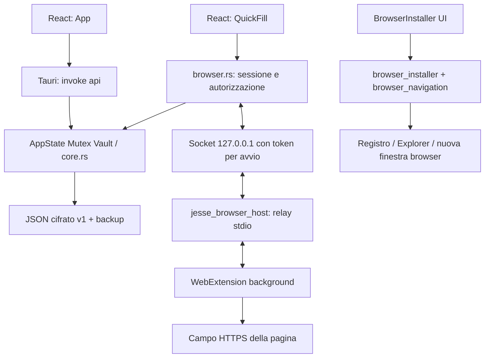

# Architettura di JesseArchive

## Baseline e metodo

Analisi statica del 17 novembre 2026, versione applicativa 1.1.4, HEAD `1f09624`. Sono stati censiti **87 file versionati: 79 testuali e 8 asset binari**. Sorgenti, configurazioni, test, script e note storiche sono stati esaminati; per l'HTML legacy è stata anche indicizzata la struttura JavaScript tramite AST, per gli asset sono stati controllati formato, dimensioni e duplicazioni. I lockfile sono stati letti come manifest risolti, non come codice applicativo.

Esclusi dall'analisi funzionale: implementazioni delle dipendenze in `node_modules/`, output in `dist/`, `target/`, `src-tauri/target/`, cache, profili di prova e altri file ignorati. Non sono state aperte configurazioni personali o vault reali. Questi output non diventano sorgenti canoniche solo perché presenti sul disco.

Le evidenze si distinguono in: **codice verificato**, **prove della sessione di sviluppo precedente** e **Da verificare**. Questo incarico non avvia l'app, non esegue migrazioni e non ricompila sorgenti. Le guide storiche in root documentano revisioni precedenti; alcune affermazioni, come “mai compilato” o “nessun remoto”, non descrivono più lo stato attuale. Per decisioni tecniche prevalgono i sorgenti correnti; queste pagine devono rimanere sincronizzate con essi.

## Componenti e flussi

L'interfaccia Tauri usa IPC nativo, non il server HTTP del vecchio client Python. L'unico listener applicativo del client Rust è il bridge browser loopback: usa JSON incorniciato e non espone route HTTP generiche del vault.

## Mappa dei file attivi

| File/area | Responsabilità |
|---|---|
| [main.rs](../src-tauri/src/main.rs) | Entry point desktop, soppressione console nelle build release |
| [lib.rs](../src-tauri/src/lib.rs) | Builder, stato condiviso, registrazione comandi, eventi e integrazione OS |
| [core.rs](../src-tauri/src/core.rs) | Modello dinamico, envelope crittografico, persistenza, dispatcher e utility |
| [importers.rs](../src-tauri/src/importers.rs) | Lettori degli export di altri programmi (dalla Beta 1.5.0): CSV con riconoscimento delle colonne e mappatura scelta dall'utente, JSON di Bitwarden, XML di KeePass. Producono record `Entry` puri; `core.rs` (`import_format`, `add_entries`, comandi `import` e `import_preview`) li aggiunge al vault in una transazione |
| [browser.rs](../src-tauri/src/browser.rs) | `Bridge`, listener, scorciatoie, selezione account e messaggi di riempimento |
| [browser_channel.rs](../src-tauri/src/browser_channel.rs) | Canale locale (dalla Beta 1.9.2): `connection.json` con permessi riservati all'utente (`write_private`), autenticazione del token con scadenza complessiva, limiti di connessioni in attesa e autenticate (`serve`), limite di frequenza dei messaggi (`Rate`) |
| [browser_save.rs](../src-tauri/src/browser_save.rs), [save-capture.js](../browser-extension/save-capture.js) | Salvataggio degli account inviati sui siti (dalla Beta 1.3.0): cattura nell'estensione, richiesta in memoria nel backend, conferma nella mini finestra |
| [browser_protocol.rs](../src-tauri/src/browser_protocol.rs) | Identificatori (estensione non pacchettizzata e ID degli store, `chromium_origins`), directory e framing condiviso |
| [jesse_browser_host.rs](../src-tauri/src/bin/jesse_browser_host.rs) | Secondo binario Cargo; relay tra browser e app già aperta |
| [browser_installer.rs](../src-tauri/src/browser_installer.rs) | Catalogo fisso di sei browser, rilevamento, apertura guida e della pagina dello store (`browser_store_open`) |
| [browser_navigation.rs](../src-tauri/src/browser_navigation.rs) | Navigazione Win32 controllata, compilata solo su Windows |
| [src/main.tsx](../src/main.tsx) | Dispatch React secondo query string |
| [App.tsx](../src/App.tsx) | Schermata auth, shell, pagine, editor e dialoghi condivisi |
| [QuickFill.tsx](../src/QuickFill.tsx) | Sblocco e selezione account senza ricevere l'intero vault nel pannello; viste passkey e «Salvare questo account?» (priorità: passkey, salvataggio, inserimento) |
| [BrowserInstaller.tsx](../src/BrowserInstaller.tsx), [BrowserSettings.tsx](../src/BrowserSettings.tsx) | Configurazione guidata e preferenze browser |
| [BackupHistory.tsx](../src/BackupHistory.tsx) | Impostazioni → Dati e backup: copie giornaliere del vault (dalla Beta 1.9.8), salvataggio altrove e recupero di elementi con `backups_list`, `backup_read`, `backup_open`, `backup_restore` (tramite `mutate`) |
| [NewsPanel.tsx](../src/NewsPanel.tsx), [news-changelog.ts](../src/news-changelog.ts), [commits.generated.json](../src/commits.generated.json) | Novità curate, cronologia Git e timestamp per voce |
| [api.ts](../src/api.ts), [types.ts](../src/types.ts) | Wrapper `invoke` e tipi frontend; non validano da soli dati esterni |
| [theme.ts](../src/theme.ts), [style.css](../src/style.css) | Otto preset, palette personalizzata e stile responsive |
| [updater.rs](../src-tauri/src/updater.rs), [Updater.tsx](../src/Updater.tsx) | Aggiornamento automatico. **Comandi:** `update_settings`, `update_set_auto`, `update_check`, `update_install`; i comandi di rete sono async con `spawn_blocking`. **Evento:** `update-progress`. **Flusso:** verifica del manifest firmato Ed25519, download in `%TEMP%\JesseArchive-Update`, avvio del setup con `ShellExecuteW` (UAC) e `/SILENT /INSTALLDIR=<cartella attuale>`, blocco del vault e uscita. **UI:** controllo automatico solo a vault sbloccato e una volta per versione per sessione, pannello «Aggiornamenti», barra di download |
| [dashboard/](../src/dashboard/) | Dashboard personalizzabile. **`model.ts`** (puro, testato in Node): tipi, specifiche dei widget (categoria, dimensioni, disponibilità, opzioni con normalizzazione), layout predefiniti, `normalizeDashboard` (configurazioni mancanti, vecchie o danneggiate → configurazione valida), griglia a posizioni fisse (`x`, `y` per widget; `placeWidget` sposta solo i widget coinvolti: scambio nello spazio lasciato libero, altrimenti primo spazio libero; le righe rimaste vuote si chiudono), operazioni sul layout, `securityScore`. **`widgets.tsx`:** registro dei widget (nome, descrizione, icona, componente, impostazioni, aggiornamento) e loro implementazioni. Aggiungere un widget = una voce qui più la sua specifica in `model.ts`. **`Dashboard.tsx`:** griglia, modalità di personalizzazione, drag & drop nativo HTML5, menu, catalogo, finestra delle impostazioni, layout. Salvataggio automatico (600 ms) con `settings` → `settings.dashboard` nel vault cifrato. Legge `health` e `backup_info` solo quando cambiano i dati da cui dipendono. **`App.tsx`:** fornisce vault, `openItem`, `selectPage`, `copy`, `lock`, risultati della verifica violazioni e id degli elementi aperti, entrambi solo di sessione |
| [i18n.ts](../src/i18n.ts), [LanguageMenu.tsx](../src/LanguageMenu.tsx), [locales/](../src/locales/), [i18n.rs](../src-tauri/src/i18n.rs) | Lingua dell'interfaccia. **Frontend:** `t()` usa il testo italiano come chiave e cade sull'italiano se manca la voce. `tRich()` inserisce elementi React nei segnaposto, `msg()` marca le costanti. `translateMessage()` traduce i messaggi del backend e dell'estensione, anche con parti variabili, usando le chiavi con `{segnaposto}` come modelli; la logica che riconosce i messaggi (per esempio "Vault bloccato") lavora sul testo italiano originale. Al cambio di lingua la radice di ogni finestra si ridisegna (`useLanguage` in `main.tsx`). **Backend:** comandi `language_get`/`language_set`, preferenza `lang` del dispositivo, etichette del tray e titoli delle finestre `quick-fill`/`browser-setup`, evento `language-changed` a tutte le finestre. **Altro:** News tradotte in `locales/news/`, nome dell'estensione nei `_locales` del browser, testi dell'installer nei `[CustomMessages]` di Inno |
| [quick_search.rs](../src-tauri/src/quick_search.rs), [clipboard.rs](../src-tauri/src/clipboard.rs), [quick-search/](../src/quick-search/), [groups.ts](../src/groups.ts) | Ricerca rapida globale. **Backend:** `setup` crea la finestra `quick-search` nascosta (senza cornice, sopra le altre, fuori dalla barra delle applicazioni) e registra la scorciatoia con lo stesso plugin global-shortcut del browser; il gestore della scorciatoia in `lib.rs` distingue le due con `quick_search::handles`. `parse_shortcut` rifiuta combinazioni senza Ctrl/Alt/Win o già usate da Windows; le due scorciatoie non possono coincidere. La finestra si nasconde quando un'altra finestra passa in primo piano o con la chiusura. Comandi: `quick_search_data` (solo metadati: `metadata`/`snapshot`), `quick_search_copy` (copia nel backend con `clipboard::copy_with_timeout`), `quick_search_reveal`, `quick_search_open_url` (`site_url`: solo http/https, ShellExecute), `quick_search_open` (mostra `main` con `window_state::show_main` ed emette `quick-search-open`: elemento, azione o pagina), `quick_search_hide`, `quick_search_clear_recent`, `quick_search_settings`, `quick_search_configure`. Tutti leggono il vault con `Vault::call` (`status`, `browser_state`); copia e visualizzazione chiamano `touch`. Gli usati di recente (`recent_ids`, `remember_item`) sono salvati con il comando `settings` in `settings.recent` del vault; lo stesso elenco è aggiornato da `openItem` in `App.tsx` (`rememberItem`) e letto dal widget «Usati di recente» della Dashboard; quando la ricerca rapida lo modifica emette `vault-changed`, così la finestra principale ricarica lo stato. `toggle` mette a fuoco anche la webview (`Webview::set_focus`), non solo la finestra, perché WebView2 riceva subito la tastiera; quel passaggio di focus alla webview genera un `Focused(false)`, quindi `focus_lost` nasconde la finestra solo se dopo 120 ms un'altra finestra è davvero in primo piano (`GetForegroundWindow`). **Frontend:** `engine.ts` (puro, riusabile da Dashboard o da una futura command palette): indice in memoria, normalizzazione, punteggio, tolleranza agli errori, raggruppamento con `groupFor` di `groups.ts` (lo stesso della lista principale, spostato da `App.tsx`). `actions.ts`: registro delle azioni rapide. `QuickSearch.tsx`: finestra, tastiera, anteprima, stati. `QuickSearchSettings.tsx`: sezione delle impostazioni. `App.tsx` ascolta `quick-search-open`. `clipboard.rs` contiene ora la logica degli appunti usata anche da `copy_secret`/`clear_secret_if_unchanged` |
| [window_state.rs](../src-tauri/src/window_state.rs) | Stato della finestra principale fra un avvio e l'altro. La finestra `main` parte nascosta (`"visible": false`); `setup` legge la preferenza `window` (`load`) e `show_main` la applica prima di mostrarla, così non c'è un salto di dimensione. Con `--background` o `--browser-setup` resta nascosta e lo stato si applica la prima volta che viene mostrata (tray, seconda istanza, fine della guida browser): massimizzare una finestra nascosta la renderebbe visibile. `track` (eventi `Resized`/`Moved`) ricorda la dimensione non massimizzata; `save` scrive allo `CloseRequested` di `main` prima di nasconderla nel tray e a `RunEvent::ExitRequested`, cioè per ogni uscita (menu del tray, chiusura, installazione di un aggiornamento) |
| [zoom.rs](../src-tauri/src/zoom.rs), [zoom.ts](../src/zoom.ts) | Zoom dell'interfaccia: livelli 50–200%, comandi `zoom_get`/`zoom_change`, evento `zoom-changed`, applicato con `set_zoom` a tutte le finestre (la finestra rapida, non ridimensionabile, scala anche le dimensioni); scorciatoie e indicatore installati da `main.tsx` in ogni finestra |

Non ci sono directory service/repository/domain separate: molte responsabilità risiedono nel monolite `core.rs`; molte schermate sono funzioni nello stesso `App.tsx`. Questa descrizione riguarda il codice reale e non un'architettura a livelli già realizzata.

## Bootstrap e ciclo di vita

1. `main.rs` chiama `run()` della libreria.
2. Il Builder installa i plugin global-shortcut e single-instance e gestisce `AppState(Mutex<core::Vault>)`.
3. `Vault::new` determina configurazione e percorso del file; non sblocca il vault.
4. `browser::setup` apre il listener, scrive il descrittore di connessione, tenta la registrazione della scorciatoia e crea `quick-fill` nascosta. Poi `quick_search::setup` crea `quick-search` nascosta e registra la sua scorciatoia, se attiva; anche questo errore è conservato per le impostazioni. Un errore della scorciatoia è conservato per l'interfaccia; altri errori di setup possono impedire l'avvio.
5. `run` crea menu e tray. `--background` nasconde `main`; `--browser-setup` apre la guida e nasconde `main`.
6. Un secondo avvio riporta in primo piano la finestra principale oppure apre la guida, secondo gli argomenti.

| Finestra | Componente | Chiusura |
|---|---|---|
| `main` | `App` | Preferenza `quit`: uscita; `tray`: blocco del vault e finestra nascosta |
| `quick-fill` | `QuickFill`, query `?quick-fill` | Annulla la sessione, pulisce lo stato UI del pannello e nasconde la finestra |
| `quick-search` | `QuickSearch`, query `?quick-search` | Nascosta perdendo il focus, con Esc o con la chiusura (Alt+F4); l'evento `quick-search-hidden` fa scartare risultati e password mostrata |
| `browser-setup` | `BrowserInstaller`, query `?browser-setup` | Nasconde la guida; il processo può rimanere nel tray. Il pulsante "Ho installato l'estensione" chiama `browser_setup_finish`, che mostra e mette a fuoco `main` e poi nasconde la guida |

Dalla Beta 1.8.1 ognuna ha il proprio file in [capabilities/](../src-tauri/capabilities/) (`main.json`, `quick-fill.json`, `quick-search.json`, `browser-setup.json`) con `core:default` e i soli permessi `allow-<comando>` dei comandi che il suo codice usa; una finestra senza file non può chiamare alcun comando. I permessi esistono perché `build.rs` dichiara tutti i comandi registrati (`AppManifest::commands`): Tauri li controlla a ogni chiamata. Inoltre `api` accetta dalla mini finestra e dalla ricerca rapida solo `unlock` e dalla guida estensioni nessun comando del vault (`api_allowed` in `lib.rs`). Vedere [SECURITY](SECURITY.md) (SEC-06) e `tests/capabilities.test.mjs`.

## Interfaccia principale e dispatcher

`App` mantiene come stato React il vault senza segreti: dalla Beta 1.8.0 `state` toglie password, PIN, CVV, numeri di carta, seed, TOTP, credenziali, chiavi WebAuthn e note (`public_item`, campo `has`), che arrivano uno alla volta con `secret`, per l'editor con `item_full` o vengono copiati nel backend con il comando Tauri `copy_vault_secret` (vedere [SECURITY](SECURITY.md#segreti-su-richiesta-dalla-beta-180)). `refresh` interroga `status` e poi `state`; `mutate` usa lo stato ritornato dal comando oppure aggiorna. `run` normalizza gli errori e gestisce `busy`, ma non elimina automaticamente il vecchio stato React su ogni errore di sessione.

Il componente esegue `ping` ogni 15 secondi mentre dispone di un vault e ascolta `vault-changed` e `vault-locked`. Dalla Beta 1.9.4 confronta il numero `rev` restituito da `ping` con quello visto al ping precedente (`seenRev`): se è cambiato (modifiche di un altro dispositivo fuse dal backend, oppure un salvataggio locale) ricarica lo stato con `refresh`, e lo fa anche al primo ping dopo lo sblocco; prima il contenuto remoto compariva solo con «Aggiorna» o dopo un salvataggio. Su tastiera, clic e rotella invia `touch` al massimo ogni 30 secondi; su `vault-locked`, o se un comando risponde "Vault bloccato"/"Sessione scaduta", `wipeSession` azzera tutto lo stato sensibile. Nel backend, `api` emette `vault-locked` quando un comando fa passare il vault da sbloccato a bloccato, e il thread `spawn_idle_lock` controlla la scadenza ogni 5 secondi con `try_lock`.

`api(app, state, name, body)` acquisisce il mutex e chiama `Vault::call`. La forma del messaggio è un nome stringa e un oggetto JSON, non un enum tipizzato condiviso. La risposta è `Value` oppure un errore stringa. Le operazioni restano serializzate, incluse parti di I/O, scrypt e richieste HTTP eseguite sotto il mutex.

| Famiglia | Comandi di `Vault::call` |
|---|---|
| Stato/sessione | `status`, `ping`, `create`, `unlock`, `lock`, `touch`, `show`, `state` (senza segreti), `browser_state` (vault completo, solo per il backend: `api` lo rifiuta) |
| Segreti su richiesta | `secret`, `item_full`, `search_notes` (dalla Beta 1.8.0) |
| Elementi e organizzazione | `item`, `trash`, `delete`, `bulk`, `folder`, `group_edit` |
| Storico e generatori | `pw_save`, `pw_link`, `pw_del`, `pw_bulk`, `generate` |
| Sicurezza e preferenze | `health`, `breach`, `totp`, `settings`, `master`, `recovery_new`, `prefs_set` |
| Trasferimento dati | `pack`, `unpack`, `export`, `import`, `loc_use`, `loc_move` |
| Utility | `group_logo`, `apps`, `app_icon`, `suggest` |

`show` nel core è un no-op riuscito: il ripristino effettivo della finestra è nei callback Tauri, non in questa route. Gli altri comandi nativi (`choose_file`, `choose_icon_data`, `read_file`, `save_file`, clipboard e `browser_*`) sono registrati separatamente e non attraversano necessariamente il gate di `Vault::call`.

## Persistenza e sincronizzazione

`save` chiama `pull`, cifra l'intero payload e invoca `atomic_write`. `pull` confronta firma del file, prova a decifrare la copia cambiata e legge eventuali `jesse_archive*.vault` nella stessa cartella. `merge_data` sceglie record per timestamp e applica tombstone. Non ci sono transazioni SQL, lock distribuiti o watch service dei provider cloud. [DATABASE](DATABASE.md) descrive schema, priorità dei timestamp, backup e limiti.

Il JSON consente estensioni e compatibilità, ma molte funzioni assumono che array e oggetti abbiano la forma attesa; i tipi TypeScript non garantiscono la validità dei dati importati o decifrati.

## Passkey WebAuthn, passo per passo

1. `passkey-page.js` (MAIN world, `document_start`, frame principale HTTPS) intercetta `navigator.credentials.create/get`. Le richieste `mediation: "conditional"` e le opzioni non valide restano al browser.
2. Le opzioni, codificate in base64url, passano con `postMessage` a `passkey-bridge.js` (mondo isolato), poi con `runtime.sendMessage` al background, che aggiunge l'origine da `sender.url`.
3. Il background invia `{kind:"passkey"}` all'host nativo. `browser.rs` lo passa a `passkey::request`, che valida la richiesta.
4. **Risposta immediata senza finestra:**
   - fallback se le passkey sono disattivate;
   - fallback per un accesso a vault sbloccato senza passkey del sito;
   - fallback se un'altra richiesta è già in corso;
   - `SecurityError` se l'rpId non è valido.
5. **Altrimenti:** la richiesta resta in `Passkeys` e la mini finestra riceve `passkey-changed`.
6. **Comandi UI:** `passkey_state`, `passkey_approve` (crea la scheda con il comando `item` del vault, oppure firma), `passkey_fallback`, `passkey_cancel`; impostazioni con `passkey_settings`/`passkey_set_enabled` (`passkeys` nella configurazione dispositivo).
7. **Esito:** l'app risponde con `passkey-result`. Il background rimette a fuoco la finestra del browser e consegna il risultato. La pagina costruisce un `PublicKeyCredential`, rilancia l'errore DOM o richiama l'API nativa (fallback).
8. **Interruzioni:** un abort della pagina, il timeout del background o la disconnessione dell'host inviano `passkey-cancel` oppure annullano la richiesta in corso.

## Integrazione browser, passo per passo

1. La scorciatoia chiama `browser::request`: una sola richiesta globale attiva, con identificatore casuale; una risposta di contesto è accettata entro 5 secondi.
2. Il worker dell'estensione verifica finestra attiva, scheda HTTPS e input selezionato. Usa `scripting.executeScript` in tutti i frame e trova il campo selezionato anche dentro shadow root aperti; invia il frame focalizzato se è HTTPS, anche di un'altra origine.
3. `receive` conserva URL, URL principale, client e richiesta. `frame_allowed` (Rust) accetta il frame se ha lo stesso `host` della pagina principale oppure, tramite `same_account_site`, lo stesso dominio registrabile PSL e la stessa porta; altrimenti la richiesta viene ignorata. Il timeout della selezione è 120 secondi.
4. `browser_accounts` usa `browser_state` e restituisce ID, titolo e username degli account compatibili, non le password (dalla Beta 1.9.3 tramite `offered_accounts`: prima l'host esatto, poi gli altri sottodomini con `saved`; `domain` è la scheda e `frame` l'host del riquadro quando è diverso). Il pannello può sbloccare il core tramite IPC.
5. `same_account_site` normalizza URL salvati senza protocollo, richiede HTTPS sulla destinazione, confronta porta e dominio registrabile tramite PSL, inclusi i suffissi privati. Dalla Beta 1.1.20 la stessa regola decide anche quali iframe di accesso sono ammessi (punto 3).
6. `browser_fill` ricontrolla stato del vault, scadenza, ID e sito; solo dopo invia username/password al client selezionato.
7. L'estensione ricontrolla richiesta, scheda, URL e riferimento DOM. Inserisce valori con setter nativo e notifiche `input/change`, sposta il focus, ma non invia il modulo. `Tab` è un evento sintetico, non una garanzia di tabulazione OS.
8. Il messaggio `filled` termina la sessione; il pannello mostra l'esito e si richiude. Login a schermate separate richiedono un nuovo richiamo del pannello.

A ogni collegamento l'estensione invia `hello` con la versione del proprio manifest e, dalla Beta 1.9.6, il proprio ID (`runtime.id`): alla copia installata da uno store (`CHROMIUM_STORE_IDS`) l'app non chiede il ricaricamento, perché la aggiorna lo store. Dalla Beta 1.9.7 invia anche `install` (`management.getSelf().installType`, senza permessi aggiuntivi; il `hello` parte quindi dopo questa lettura asincrona): se presente, `should_reload` ricarica solo `development`, cioè la copia caricata a mano; senza `install` (estensioni precedenti) vale la regola sull'ID. Se è più vecchia di quella dell'app (`needs_reload`, confronto numerico di `updater::is_newer`), `browser.rs` risponde `reload` e l'estensione chiama `runtime.reload()`, che rilegge i file sostituiti dal setup. `reload_asked` limita la richiesta a una volta per versione e per avvio dell'app, così una copia caricata da un'altra cartella non si ricarica in ciclo.

Il relay usa 4 byte little-endian di lunghezza e un oggetto JSON UTF-8, massimo 262144 byte. Il primo frame TCP porta il token per avvio. Il listener autentica entro 3 secondi e poi mantiene la connessione; non c'è TLS. L'helper legge il descrittore da AppData, controlla gli identificatori ammessi negli argomenti e inoltra i frame. Non avvia automaticamente l'app se è chiusa. Vedere [SECURITY](SECURITY.md) per il modello di fiducia locale.

## Salvataggio degli account, passo per passo

Dalla Beta 1.3.0.

1. `save-capture.js` (mondo isolato, tutti i frame HTTPS, `document_start`) segna i campi che ricevono eventi `input`/`paste`/`keydown` fidati (`isTrusted`). Su `submit`, clic su un pulsante o Invio, cerca il modulo (o, senza `<form>`, l'antenato più vicino con una password digitata), anche dentro shadow root aperti.
2. **Classificazione:** una password = login; due uguali o `new-password` = registrazione; attuale + nuova (+ conferma) o `current-password`/`new-password` = cambio, con `old`. Conferme diverse, coppie ambigue e password invariate vengono ignorate. Gli altri campi testuali compilati (al massimo 12) diventano `fields` con etichetta, token `autocomplete` e tipo; sono esclusi dati di pagamento, codici OTP, captcha, ricerche e campi nascosti. `user` indica il campo identificativo (username dichiarato, nome simile a username, email, ultimo campo prima della password).
3. Il primo passo di un login in due passaggi (solo identificativo) invia `save-user`: il background lo tiene in memoria per la scheda e lo stesso host fino a 5 minuti e lo aggiunge al successivo `save` senza username.
4. Il background accetta solo messaggi della propria estensione da una scheda HTTPS, prende `url` e `top` da `sender`, e inoltra `{kind:"save"}` solo se l'app ha inviato `{kind:"config",save:true}` (a ogni `hello` e quando l'opzione cambia); appena avviato attende la configurazione fino a 3 secondi, poi scarta.
5. `browser_save::receive`: preferenza `save_logins` del dispositivo, `frame_allowed`, limiti di lunghezza e caratteri di controllo, `site` = dominio registrabile della scheda (PSL, con porta). Con vault sbloccato `decide` confronta gli account di quel sito (`matching`): stessa password per lo username (o per qualsiasi account se manca lo username) = niente; password attuale di un cambio o username già salvato = `Update`; altrimenti `New`; sito in `settings.never_save` = niente. Dopo «Non ora» lo stesso sito tace per 2 minuti.
6. La richiesta resta in `Saves` (una sola, password in `Zeroizing`, scadenza 3 minuti); la mini finestra riceve `save-changed`. Una nuova richiesta di inserimento (scorciatoia) la scarta.
7. **Comandi UI:** `browser_save_state` (sito, modalità, titolo suggerito, campi e indice dello username, mai la password; con vault bloccato solo il sito, la finestra chiede lo sblocco e poi ridecide), `browser_save_approve` (titolo, username, note scelte: crea l'account con `item`, URL `https://<dominio>`, gruppo `web:<dominio>` e richiesta del logo come dal salvataggio manuale, oppure aggiorna solo la password dell'account esistente, con la cronologia delle password), `browser_save_dismiss` (`never` aggiunge il sito a `settings.never_save`), `browser_save_settings`, `browser_save_set_enabled`, `browser_save_forget` (toglie il sito dall'elenco e anche dall'eventuale pausa di «Non ora»; «Mai per questo sito» non crea pause).

Eventi principali: `vault-changed`, `vault-locked`, `browser-changed`, `browser-result`, `browser-dismissed`, `zoom-changed`, `update-progress`, `passkey-changed`, `save-changed`, `language-changed`. Il pannello rapido aggiorna i metadati ogni 3 secondi quando attivo; le impostazioni browser interrogano lo stato ogni 5 secondi.

## Guida e risorse di distribuzione

`browser_installer` rileva eseguibili da App Paths nelle viste registro 32/64 bit e da directory standard. I sei identificatori sono una allowlist fissa. Dalla Beta 1.9.7 `browser_store_open` riceve solo l'identificatore del browser, sceglie l'indirizzo fisso dello store (`store_url`: Chrome Web Store con il primo `CHROMIUM_STORE_IDS`, oppure addons.mozilla.org) e lo passa all'eseguibile rilevato: un indirizzo https non è filtrato dalla riga di comando come le pagine interne. Per l'installazione manuale `browser_navigation` apre una nuova finestra `about:blank`, cerca una nuova HWND del browser atteso e inserisce l'indirizzo dalla barra dopo aver verificato il primo piano. Non installa estensioni né modifica profili.

La sorgente canonica del worker è [browser-extension/background.js](../browser-extension/background.js). Le copie in `chromium/` e `firefox/` sono generate e risultavano identiche nell'analisi. `public-key.txt` contiene una chiave pubblica per stabilizzare l'ID Chromium, non un segreto e non una firma dello store. Non rigenerarla incidentalmente: l'ID è compilato nell'helper tramite `include_str!`.

[Build-Distribuzione-Windows.ps1](../Build-Distribuzione-Windows.ps1) prepara helper, copie, manifest e un merge di configurazione Tauri per includerli come risorse. [Build-Setup-EXE.ps1](../Build-Setup-EXE.ps1) compila il programma senza pacchetto Tauri e produce con Inno l'unico installer (dalla Beta 1.2.0), che installa anche WebView2 se manca e sostituisce le vecchie installazioni MSI. Il comando Tauri diretto e il vecchio `Build-Windows.ps1` non eseguono questo intero flusso. Vedere [DEVELOPMENT](DEVELOPMENT.md).

## Inventario complementare e duplicazioni

- `fixtures/legacy_v1_synthetic.json` è una fixture crittografica pubblica di test; non riprodurne valori nel manuale.
- `tests/` contiene i test Node e uno Python (vettore crittografico della fixture v1); i test Rust sono inline nei moduli.
- `package-lock.json` e `src-tauri/Cargo.lock` fissano le risoluzioni. Nessun `rust-toolchain.toml` o `.cargo/config.toml` è versionato; la CI è in `.github/workflows/ci.yml` (vedere [DEVELOPMENT](DEVELOPMENT.md#integrazione-continua)).
- `installer/art/` contiene le immagini dell'installer Inno (sfondo, pannello laterale, logo piccolo), una per ciascuna scala DPI dal 100% al 250% alla misura esatta dell'area indicata dalla documentazione di Inno Setup 7, così il setup non le ridimensiona. Sono generate da `scripts/installer-art.ps1` a partire dall'illustrazione originale a 360 px `installer/art-source/jesse-logo-original.jpg` (la stessa di `public/jesse-logo.png`, che è a 256 px). `public/` contiene favicon e logo; `src-tauri/installer-assets/` contiene le bitmap NSIS/WiX, non più usate dal setup distribuito, (`banner`, `dialog`, `nsis-header`, `nsis-sidebar`) e le otto `inno-small-*.bmp`: logo quadrato per l'angolo in alto a destra dell'installer Inno, una per scala DPI. Sono generate da `public/jesse-logo.png` su fondo bianco; `nsis-sidebar.bmp` resta l'immagine laterale. Le due ICO in `public/` e `src-tauri/` hanno contenuto identico: duplicazione di risorse per tool diversi.
- `src/style.css` ha regole iniziali e successivi override per tema e schermate. Non importa font o CSS remoti; la cascata conta più dell'ordine storico dei commenti. Dalla Beta 1.8.3 non contiene più dichiarazioni sovrascritte da una regola successiva con lo stesso selettore nello stesso contesto `@media` (16 rimosse) né le regole di `.panel-bottom`, classe non usata: pulizia verificata confrontando, per ogni selettore e proprietà, la dichiarazione vincente e il loro ordine prima e dopo (identici). Le ridefinizioni in contesti diversi (tema, schermi stretti) e le classi composte a runtime (`size-${…}` della dashboard) sono volute.
- `.editorconfig` e `.gitattributes` definiscono UTF-8 e fine riga, con CRLF per PowerShell/Inno. `.gitignore` esclude artefatti, vault e molti formati sensibili: non è uno scanner dei segreti già tracciati.
- Le note storiche in root sono state esaminate come contesto, non come test correnti. La storia iniziale ricostruita è spiegata in [GIT-HISTORY.md](../GIT-HISTORY.md).

## Client Python storico e parti non attive

Dalla Beta 1.8.2 la vecchia applicazione Python (`legacy-python/`) non è più nella repository e resta nella cronologia Git (commit `388f0e4`, ultima versione nel commit precedente alla rimozione). Era una seconda applicazione con server HTTP su loopback, pywebview/pystray e frontend imperativo, mai chiamata dal client Rust; alcuni suoi comportamenti (rinomina delle copie di conflitto in `.merged`, spostamento del file originale con `loc_move`, foglio di emergenza e backup `.jbackup`) non sono mai appartenuti al client Rust. Il formato dei suoi vault (v1) resta supportato e verificato dalla fixture sintetica `fixtures/legacy_v1_synthetic.json`.

Non è stata dimostrata l'inutilità di ogni simbolo apparentemente ridondante: `show` rimane un contratto legacy (`touch` è di nuovo usato dalla UI per l'attività), gli asset duplicati servono tool differenti e le copie JS hanno un generatore. Le opportunità di pulizia e i contratti da chiarire sono proposte in [ROADMAP](ROADMAP.md), non autorizzazioni a eliminare file.
